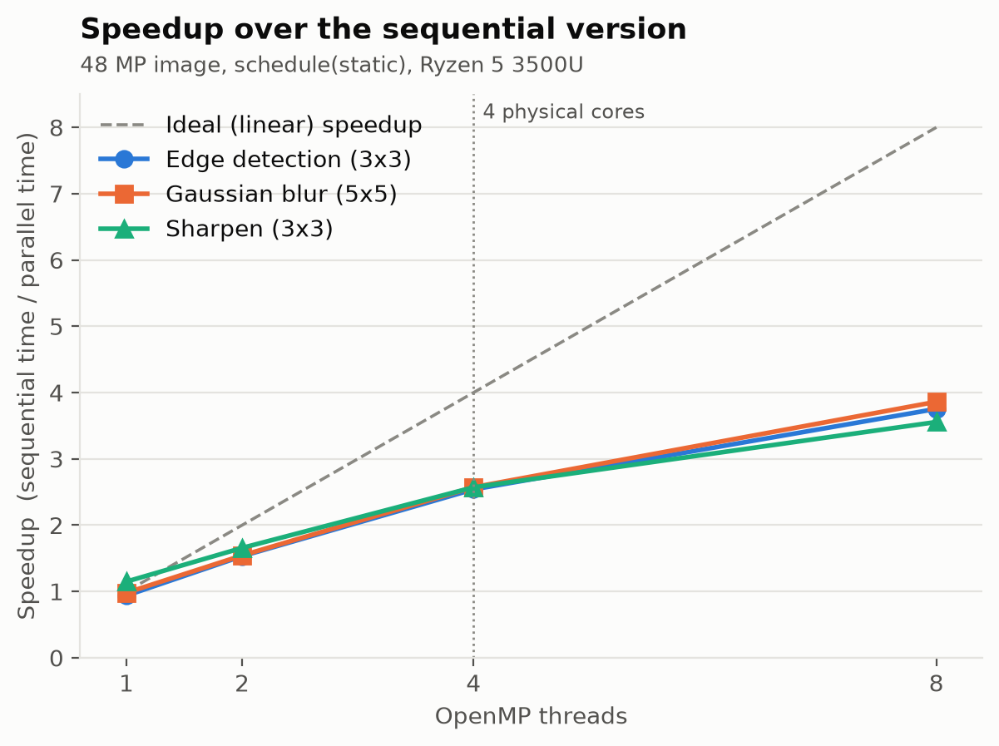
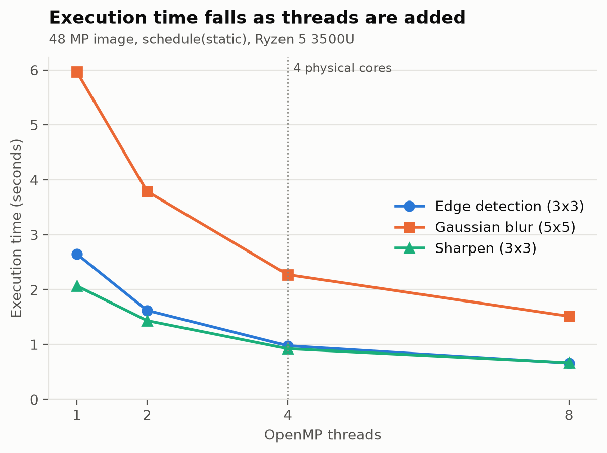
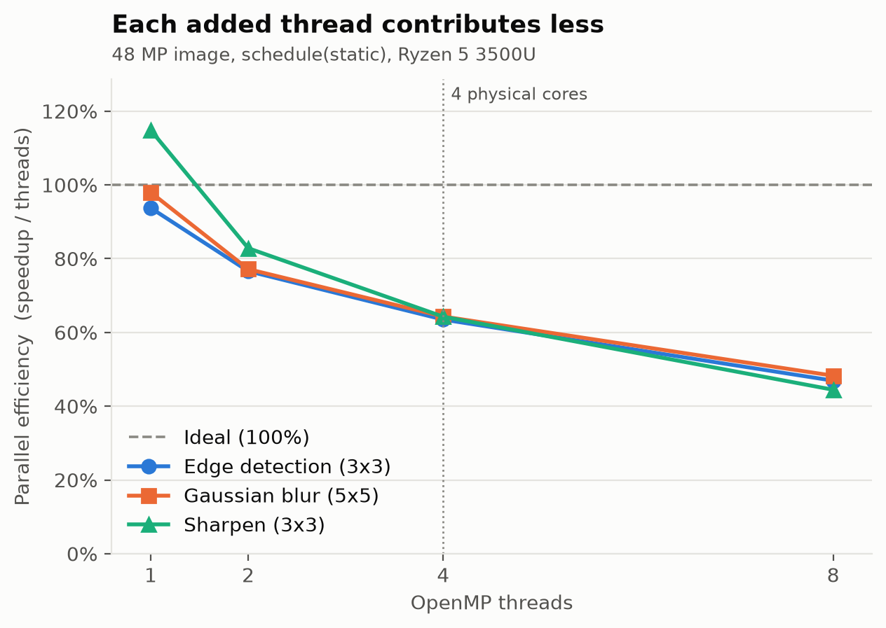
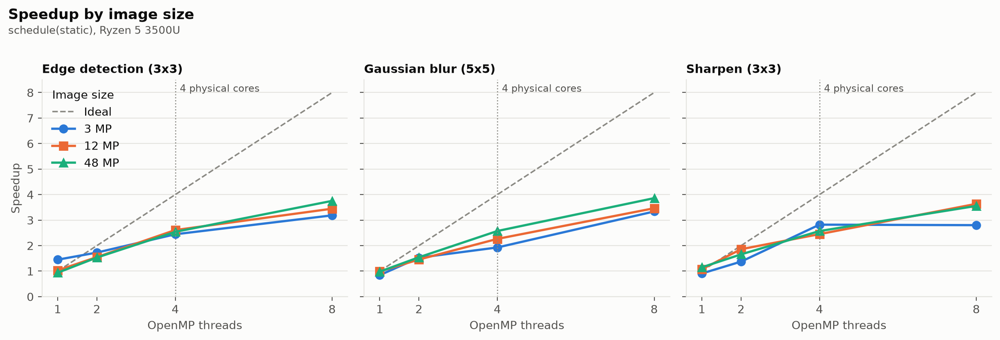

# Parallel Image Convolution with OpenMP

Semester project for Parallel and Distributed Computing. It applies
convolution filters (edge detection, Gaussian blur, sharpening) to large
images, once sequentially and once with OpenMP, and compares the two.

## Status

| Phase | Work | State |
|---|---|---|
| 1 | Project setup | done |
| 2 | Sequential convolution | done |
| 3 | OpenMP parallelisation | done |
| 4 | Benchmark mode over workload sizes and thread counts | done |
| 5 | Speedup and efficiency graphs | done |
| 6 | Report and demonstration | report drafted |

## Documents

- [Project report](docs/REPORT.md)
- [Viva preparation sheet](docs/VIVA.md): questions and answers, and a demo script

## Requirements

- CMake 3.16 or newer
- A C++17 compiler with OpenMP: Visual Studio (MSVC), or g++ / clang++

No third-party libraries are needed.

## Build

```bash
cmake -S . -B build
cmake --build build --config Release
```

With Visual Studio the programs end up in `build/Release/`; with g++ or
clang++ they are directly in `build/`. The commands below use the Visual
Studio paths.

## Run

Correctness tests:

```bash
./build/Release/test_convolve.exe
```

Sequential run on a generated 8000x6000 image:

```bash
./build/Release/convolve.exe --generate 8000x6000 --filter blur
```

OpenMP run with 4 threads, checked against the sequential result:

```bash
./build/Release/convolve.exe --generate 8000x6000 --filter blur --threads 4 --compare
```

Filter a real image and save the result:

```bash
./build/Release/convolve.exe --input photo.bmp --filter edge --threads 8 --output edge.bmp
```

| Option | Meaning |
|---|---|
| `--generate WxH` | create a synthetic test image of that size |
| `--input FILE` | load a 24-bit BMP instead |
| `--filter NAME` | `edge`, `blur` or `sharpen` |
| `--threads N` | use the OpenMP version with N threads (omit for sequential) |
| `--schedule NAME` | `static` (default), `dynamic` or `guided` |
| `--compare` | also run sequentially, verify identical output, print speedup |
| `--output FILE` | save the filtered image |
| `--save-input FILE` | save the unfiltered image |

Input images must be 24-bit uncompressed BMP. In Paint: *Save as* then
*24-bit Bitmap*.

## How it works

**Convolution.** For every pixel, a small grid of weights (the kernel) is
centred on it, each neighbouring pixel is multiplied by the weight above it,
and the products are added up. This is done separately for red, green and
blue. Neighbours that fall outside the image use the nearest pixel inside it.

| Filter | Kernel | Effect |
|---|---|---|
| edge | 3x3 Laplacian, weights sum to 0 | flat areas go black, boundaries stay |
| blur | 5x5 Gaussian, weights sum to 1 | each pixel becomes a weighted average of its neighbourhood |
| sharpen | 3x3, weights sum to 1 | differences from the 4 neighbours are amplified |

**Why it parallelises well.** The filter reads only the input image and
writes only the output image, which is a separate buffer. So the value of one
output pixel never depends on another output pixel, and the rows can be
computed in any order, or at the same time.

**The OpenMP version.** The loop over rows is marked with
`#pragma omp parallel for`. OpenMP splits the rows among the threads; each
thread writes its own rows of the output and nothing else, so no locks,
critical sections or reductions are needed. Both versions call the same
`convolve_row` function, so the parallel output is byte-for-byte identical to
the sequential one, and the tests check that.

## Source layout

| File | Contents |
|---|---|
| `src/convolve.cpp` | `convolve_sequential` and `convolve_parallel` |
| `src/kernels.cpp` | the three kernels |
| `src/image.cpp` | image struct, BMP load/save, test image generator |
| `src/main.cpp` | command-line program and timing |
| `src/benchmark.cpp` | benchmark over sizes, filters and thread counts |
| `scripts/plot_results.py` | turns the benchmark CSV into graphs |
| `tests/test_convolve.cpp` | correctness tests |

## Benchmarks

```bash
./build/Release/benchmark.exe
```

This times the sequential version and the OpenMP version for every
combination of image size, filter and thread count, checks each parallel
output against the sequential one, and writes `results/benchmark.csv`.

| Option | Default |
|---|---|
| `--sizes LIST` | `2000x1500,4000x3000,8000x6000` |
| `--filters LIST` | `edge,blur,sharpen` |
| `--threads LIST` | 1, 2, 4, ... up to the number of logical processors |
| `--schedules LIST` | `static` |
| `--repeats N` | 3 |
| `--output FILE` | `results/benchmark.csv` |

Each configuration is run `--repeats` times. The runs are interleaved: one
round runs the sequential version and then every thread count, then the next
round starts. A laptop CPU changes speed as it heats up, so running all the
sequential measurements first and all the 8-thread ones last would mix that
drift into the speedup figures. The fastest run (`best_ms`) is used for
speedup, because interference from other programs can only slow a run down;
the average (`mean_ms`) is recorded too.

- Speedup = sequential time / parallel time
- Efficiency = speedup / threads

For clean numbers, close other programs and plug the laptop in.

## Graphs

```bash
pip install matplotlib
python scripts/plot_results.py --physical-cores 4 --machine "Ryzen 5 3500U"
```

This reads `results/benchmark.csv` and writes four PNG files to `plots/`.

### Results

AMD Ryzen 5 3500U (4 cores, 8 hardware threads), MSVC Release build, static
schedule, best of 5 interleaved runs. Full data is in `results/benchmark.csv`.









Speedup on the 8000x6000 (48 megapixel) image:

| Filter | Sequential | 1 thread | 2 threads | 4 threads | 8 threads |
|---|---|---|---|---|---|
| edge 3x3 | 2483 ms | 0.94 | 1.53 | 2.54 | 3.75 |
| blur 5x5 | 5847 ms | 0.98 | 1.54 | 2.57 | 3.86 |
| sharpen 3x3 | 2376 ms | 1.15 | 1.66 | 2.57 | 3.56 |

Speedup at 8 threads as the image grows:

| Filter | 3 MP | 12 MP | 48 MP |
|---|---|---|---|
| edge 3x3 | 3.19 | 3.45 | 3.75 |
| blur 5x5 | 3.34 | 3.47 | 3.86 |
| sharpen 3x3 | 2.80 | 3.64 | 3.56 |

What the numbers show:

- Up to 4 threads, each thread has its own physical core, and speedup reaches
  about 2.5x (about 64% efficiency).
- From 4 to 8 threads the extra threads share cores through simultaneous
  multithreading, so doubling the threads adds only about 1.4 to 1.5x more.
- Larger images scale slightly better at 8 threads, though the difference is
  close to the measurement noise.

The measurements were taken on a laptop that was in use, so some noise
remains: 1-thread OpenMP runs, which should equal the sequential time, land
between 0.84 and 1.45 of it on the smallest image and between 0.94 and 1.15
on the two larger ones.

### Schedule comparison

```bash
./build/Release/benchmark.exe --sizes 8000x6000 --schedules static,dynamic,guided --output results/schedules.csv
```

Time in milliseconds on 8 threads, 48 MP image, best of 5 interleaved runs
(`results/schedules.csv`):

| Filter | Sequential | static | dynamic, chunk 16 | guided, chunk 16 |
|---|---|---|---|---|
| edge 3x3 | 2924 | 567 | 512 | 578 |
| blur 5x5 | 5437 | 1446 | 1289 | 1271 |
| sharpen 3x3 | 1999 | 667 | 598 | 590 |

Dynamic was about 10% faster than static on 8 threads for all three filters;
guided was faster for two and slightly slower for one. At 1 to 4 threads the
differences are within the noise. This run was a separate session from the
results above and its absolute speedups are higher, so compare schedules only
within this table.
