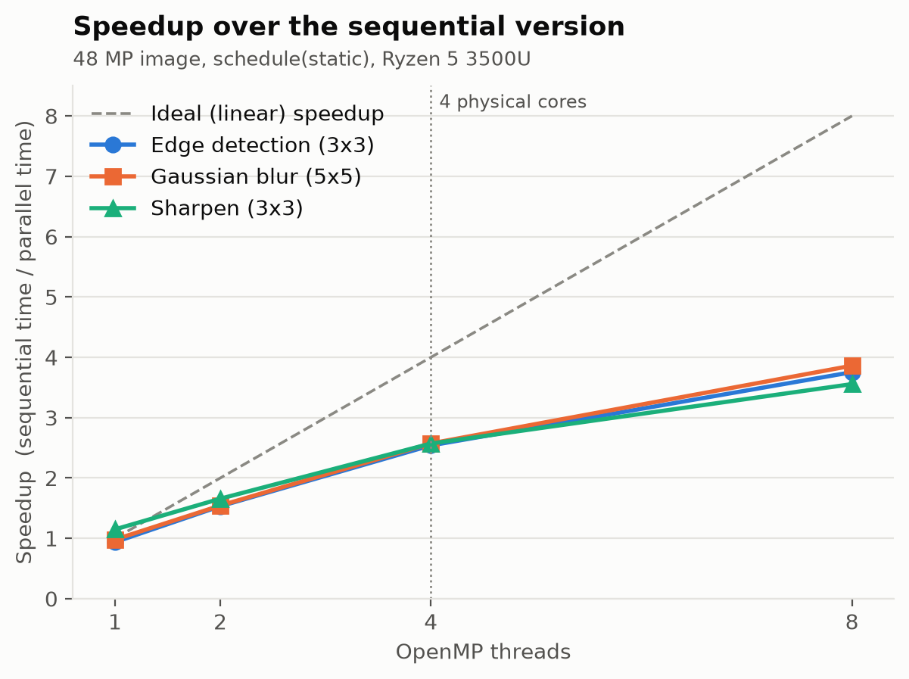

# Parallel Image Convolution using OpenMP — Project Report

16 November 2026

## Abstract

An OpenMP implementation of image convolution ran 3.6 to 3.9 times faster than the sequential version on 8 threads, and about 2.5 times faster on 4 threads, for a 48-megapixel image. The project implements edge detection, Gaussian blur and sharpening in C++, first sequentially and then in parallel by dividing the image rows among threads. The parallel output is byte-for-byte identical to the sequential output in every tested configuration. Measurements on a 4-core, 8-thread laptop cover three image sizes, four thread counts and three OpenMP schedules. Parallel efficiency falls from about 80% on 2 threads to under 50% on 8, because the last four threads share physical cores.

## 1. Introduction and problem statement

Convolution filters repeat the same small calculation for every pixel of an image, so the cost grows directly with image size. A 48-megapixel image needs 48 million neighbourhood sums per colour channel, and a sequential program computes them one after another on a single core while the other cores sit idle.

This project parallelises that calculation with OpenMP and measures the benefit. The objectives, taken from the proposal, are:

- a correct sequential implementation to serve as the baseline;
- an OpenMP implementation of the same operation;
- three representative filters: edge detection, Gaussian blur and sharpening;
- workloads large enough for timing differences to be measurable;
- measurements of execution time, speedup and parallel efficiency at different thread counts and image sizes.

Group members: Syed Anfas, Asher Ahmed, Farrukh.

## 2. Background: convolution and the filters

Convolution replaces each pixel with a weighted sum of the pixels around it. The weights form a small square grid called the kernel. For a kernel K of radius r, the output pixel at (x, y) is:

```latex
O(x, y) = \sum_{i=-r}^{r} \sum_{j=-r}^{r} K(i, j) \, I(x - i,\; y - j)
```

The sum is computed separately for the red, green and blue channels. Each result is rounded and clamped to the range 0 to 255. Neighbours that fall outside the image are replaced by the nearest pixel inside it (clamp to edge).

| Filter | Kernel | Sum of weights | Effect |
| --- | --- | --- | --- |
| Edge detection | 3x3 Laplacian: 8 in the centre, -1 in the eight neighbours | 0 | Flat regions become black; only intensity changes remain |
| Gaussian blur | 5x5 binomial (1 4 6 4 1 in each direction), divided by 256 | 1 | Each pixel becomes a weighted average of its neighbourhood |
| Sharpening | 3x3: 5 in the centre, -1 in the four direct neighbours | 1 | Differences from the neighbours are amplified |

A 3x3 kernel costs 9 multiply-adds per channel per pixel and a 5x5 kernel costs 25. The blur is therefore the heaviest of the three workloads.

## 3. Sequential implementation

The program is written in C++17 with no third-party libraries. Four design decisions shape both the sequential and the parallel version.

- **Flat image buffer.** An image is one contiguous array of bytes in R, G, B order, row by row. Each row is a single block of memory, which suits both the cache and a row-based split among threads.
- **Separate output buffer.** The filter reads the input image and writes a second image. Filtering in place would be wrong, because later pixels would read neighbours that had already been overwritten.
- **One shared row function.** A function `convolve_row` computes one complete output row. The sequential version calls it for rows 0 to height-1 in order.
- **True convolution.** The kernel is flipped in both directions, as the definition requires. The three filters are symmetric, so this does not change their output, but a test with an asymmetric kernel confirms it.

```cpp
Image convolve_sequential(const Image& input, const Kernel& kernel) {
    Image output(input.width, input.height);
    // in, out, weights: raw pointers to the three buffers
    for (int y = 0; y < height; ++y)
        convolve_row(in, out, width, height, weights, kernel.size, y);
    return output;
}
```

Images are read and written as 24-bit BMP, which needs no external library. A deterministic generator also produces synthetic images of any size (colour gradients, a checkerboard, concentric rings and noise), so large workloads do not depend on a dataset.

Only the convolution is timed. Loading, generating and saving images are excluded because they are not the work being parallelised.

## 4. OpenMP parallelisation

The loop over image rows is parallelised with a single `parallel for` directive, and no locks, critical sections or reductions are needed.

```cpp
#pragma omp parallel for num_threads(num_threads) schedule(static)
for (int y = 0; y < height; ++y)
    convolve_row(in, out, width, height, weights, ksize, y);
```

**Why this is safe.** Every output pixel depends only on the input image, never on another output pixel. The iterations of the row loop are therefore independent and can run in any order or at the same time.

| Data | Sharing | Reason |
| --- | --- | --- |
| Input image, kernel weights | Shared | Read only during filtering |
| Output image | Shared | Each row is written by exactly one thread, so no two threads write the same byte |
| Loop variable `y` | Private | Made private automatically by `parallel for` |
| `x`, the running sums and other locals of `convolve_row` | Private | They live on each thread's own stack |

**Why the row loop.** Parallelising the outer loop gives each thread many whole rows. Threads are started once and work on large contiguous blocks of memory. Parallelising the pixel loop or the kernel loops instead would pay the work-sharing overhead once per row or once per pixel.

**Scheduling.** With `schedule(static)` the rows are divided into one equal band per thread before the loop starts. Every row costs the same amount of work, so equal bands give balanced load with no bookkeeping at run time. The program also supports `dynamic` and `guided` with a chunk of 16 rows, and section 8 compares the three.

**Identical arithmetic.** Both versions call the same `convolve_row`, and each pixel's sum is accumulated in the same order. The parallel output is therefore byte-for-byte identical to the sequential output, not merely close to it.

## 5. Correctness verification

All 11 automated tests pass, and every benchmark run also compares its parallel output with the sequential one.

The sequential version is checked on inputs whose correct output is known in advance:

| Test | Expected result |
| --- | --- |
| Identity kernel (1 in the centre) | Image unchanged |
| Blur of a constant image | Same constant, including at the borders |
| Sharpen of a constant image | Same constant |
| Edge detection of a constant image | All black |
| Asymmetric kernel | Image shifted by one pixel in the direction convolution predicts |
| Blur of a single bright pixel | The Gaussian kernel itself |
| BMP save then load, width not a multiple of 4 | Identical image |

The parallel version is then compared byte for byte with the sequential one for each filter, under all three schedules and with 1, 2, 3, 4, 7, 8 and 16 threads. These counts include values that do not divide the row count evenly and more threads than the machine has cores. A further test uses an image with 3 rows and 8 threads, so that some threads receive no work.

## 6. Experimental setup

Every configuration was run 5 times on a 4-core, 8-thread laptop, and the fastest run is reported.

| Item | Value |
| --- | --- |
| Processor | AMD Ryzen 5 3500U, 4 physical cores, 8 hardware threads |
| Operating system | Windows 11 Pro |
| Compiler | Microsoft Visual C++ 14.50, Release build, OpenMP 2.0 |
| Image sizes | 2000x1500 (3 MP), 4000x3000 (12 MP), 8000x6000 (48 MP) |
| Filters | Edge detection 3x3, Gaussian blur 5x5, sharpening 3x3 |
| Thread counts | 1, 2, 4, 8 |
| Timer | `omp_get_wtime()`, wall-clock time around the convolution call only |

The metrics are defined as follows, where T\_seq is the sequential time and T\_p the time with p threads:

```latex
S(p) = \frac{T_{seq}}{T_p} \qquad\qquad E(p) = \frac{S(p)}{p}
```

Two choices in the method reduce measurement noise.

- **Fastest of 5 runs.** Interference from other programs can only make a run slower, never faster, so the minimum is the value least affected by it.
- **Interleaved runs.** Each round runs the sequential version once and then every thread count once, before the next round begins. A laptop processor changes speed as it heats up. If all sequential runs came first and all 8-thread runs last, that drift would be mistaken for speedup or slowdown.

The second choice was added after the first measurements. Without interleaving, the sequential baseline for the same workload varied by about 30% between runs.

## 7. Results

On the 48-megapixel image the OpenMP version is about 2.5 times faster than the sequential version on 4 threads and 3.6 to 3.9 times faster on 8 threads.



*Source: results/benchmark.csv, best of 5 interleaved runs, Ryzen 5 3500U, 16 November 2026.*

The three filters scale almost identically, although the blur does nearly three times the arithmetic per pixel. The curves fall below the ideal line from 2 threads onwards, and the gap widens most beyond the 4 physical cores.

### Execution time

Time in seconds for the 48 MP image:

| Filter | Sequential | 1 thread | 2 threads | 4 threads | 8 threads |
| --- | --- | --- | --- | --- | --- |
| Edge detection 3x3 | 2.48 | 2.65 | 1.62 | 0.98 | 0.66 |
| Gaussian blur 5x5 | 5.85 | 5.97 | 3.79 | 2.27 | 1.51 |
| Sharpening 3x3 | 2.38 | 2.07 | 1.43 | 0.92 | 0.67 |

The OpenMP version with 1 thread takes about the same time as the sequential version, so OpenMP itself adds no measurable overhead for this workload.

### Parallel efficiency

Efficiency is 77% to 83% on 2 threads, 63% to 64% on 4 threads and 44% to 48% on 8 threads. Each added thread contributes less than the one before it.

### Scalability with image size

Speedup on 8 threads for each image size:

| Filter | 3 MP | 12 MP | 48 MP |
| --- | --- | --- | --- |
| Edge detection 3x3 | 3.19 | 3.45 | 3.75 |
| Gaussian blur 5x5 | 3.34 | 3.47 | 3.86 |
| Sharpening 3x3 | 2.80 | 3.64 | 3.56 |

Speedup tends to rise with image size for edge detection and blur. The sharpening figures do not follow the trend, and the 3 MP runs last well under half a second, so differences of this size are within the measurement noise.

## 8. Schedule comparison

The three schedules performed within about 12% of each other, and static was not the fastest on 8 threads, contrary to what section 4 predicted.

Time in milliseconds on 8 threads for the 48 MP image, best of 5 interleaved runs:

| Filter | Sequential | static | dynamic, chunk 16 | guided, chunk 16 |
| --- | --- | --- | --- | --- |
| Edge detection 3x3 | 2924 | 567 | 512 | 578 |
| Gaussian blur 5x5 | 5437 | 1446 | 1289 | 1271 |
| Sharpening 3x3 | 1999 | 667 | 598 | 590 |

Dynamic was 10% to 11% faster than static for all three filters. Guided was 11% to 12% faster for blur and sharpening and 2% slower for edge detection. On 1, 2 and 4 threads the schedules differed by amounts no larger than the run-to-run noise.

A likely explanation is that the threads do not all run at the same speed, even though every row costs the same work. On 8 threads, pairs of threads share a physical core, and the laptop was running other programs. Under the static schedule a thread that is slowed down still has to finish its whole band, and the loop waits for it. Under dynamic and guided scheduling the faster threads take over the remaining rows. This explanation was not tested separately.

The cost of dynamic scheduling is small here because a chunk of 16 rows of an 8000-pixel-wide image is a large unit of work compared with the cost of requesting it.

This comparison was measured in a separate session from section 7. Its absolute speedups differ from that section (for example 5.15 against 3.75 for edge detection with the static schedule), so only the comparison between schedules within this table should be relied on.

## 9. Discussion

The program has almost no sequential part, so the gap between measured and ideal speedup comes from the hardware rather than from the algorithm.

**Amdahl's law does not explain the gap.** If a fraction f of the work is sequential, the speedup on p threads is limited to:

```latex
S(p) \le \frac{1}{f + \dfrac{1 - f}{p}}
```

The only sequential work inside the timed region is allocating and zero-filling the output image, a few percent of the total at most. With f = 0.03 the limit on 4 threads would be about 3.7, well above the measured 2.5. Three hardware effects are the likely causes. None of them was measured separately in this project.

- **Shared physical cores.** The processor has 4 cores and 8 hardware threads. Threads 5 to 8 share the arithmetic units of cores that are already busy, so doubling from 4 to 8 threads added only about 1.4 to 1.5 times more speed.
- **Processor frequency.** Laptop processors run a single busy core at a higher clock speed than all cores together. The sequential baseline benefits from this and the multi-threaded runs do not, which lowers the speedup even at 2 and 4 threads.
- **Shared memory bandwidth.** A 48 MP image is 144 MB, and the output is another 144 MB. All threads read and write through the same memory channels, so memory throughput does not grow with the thread count.

**Limitations.**

- The measurements come from one laptop that was in use during the runs. The 1-thread OpenMP time, which should equal the sequential time, was between 0.94 and 1.15 of it on the two larger images and between 0.84 and 1.45 on the 3 MP image.
- Absolute speedups differed between measurement sessions on the same machine. Figures should be compared within one session, not across sessions.
- Only BMP images are supported, and the experiments used synthetic images. Image content does not affect the running time of a convolution, so this does not change the timings.

## 10. Conclusion and future work

One OpenMP directive on the row loop made image convolution 3.6 to 3.9 times faster on a 4-core, 8-thread laptop, with output identical to the sequential version.

The project met each objective of the proposal: a tested sequential baseline, an OpenMP version, three filters, workloads of up to 48 megapixels, and measurements of time, speedup, efficiency and scalability. Convolution suited OpenMP well because every output pixel is independent, so the parallel version needed no synchronisation at all. Efficiency fell from about 80% on 2 threads to under 50% on 8, which shows that the hardware, not the algorithm, set the limit.

Possible extensions:

- repeat the measurements on a desktop or server processor with more physical cores and stable clock speed;
- parallelise the allocation of the output image, the one sequential step that remains;
- use separable kernels for the Gaussian blur, which reduces 25 multiply-adds per pixel to 10;
- add SIMD vectorisation inside each row, which combines with threading;
- process a batch of images with one image per thread and compare it with the row-level approach.

## Appendix: building and running

The project needs CMake 3.16 or newer and a C++17 compiler with OpenMP. With Visual Studio the programs are placed in `build/Release/`.

```bash
cmake -S . -B build
cmake --build build --config Release

# correctness tests
./build/Release/test_convolve.exe

# one filter, 8 threads, checked against the sequential result
./build/Release/convolve.exe --generate 8000x6000 --filter blur --threads 8 --compare

# filter a real 24-bit BMP and save the result
./build/Release/convolve.exe --input photo.bmp --filter edge --threads 8 --output edge.bmp

# full benchmark, then graphs
./build/Release/benchmark.exe --repeats 5
python scripts/plot_results.py --physical-cores 4
```

| File | Contents |
| --- | --- |
| `src/convolve.cpp` | `convolve_sequential`, `convolve_parallel` and the shared `convolve_row` |
| `src/kernels.cpp` | The three kernels |
| `src/image.cpp` | Image structure, BMP input and output, test image generator |
| `src/main.cpp` | Command-line program |
| `src/benchmark.cpp` | Benchmark over sizes, filters, schedules and thread counts |
| `tests/test_convolve.cpp` | Correctness tests |
| `scripts/plot_results.py` | Graphs from the benchmark CSV |
| `results/`, `plots/` | Measured data and generated graphs |
